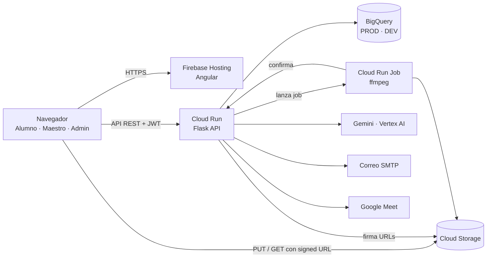

# ITDAR — Plataforma académica 
### Caso de estudio · Desarrollo full-stack con enfoque backend

Plataforma web que digitalizó la gestión académica del Instituto Teológico
David Arcos Ríos (Río Blanco, Veracruz) y que hizo posible abrir su
modalidad virtual.

**Sitio en producción:** [itdar.org](https://itdar.org) · En uso desde 18 de abril de 2023
El código fuente es privado porque maneja datos institucionales.
Puedo mostrarlo y explicarlo en una entrevista.

---

## Contexto
ITDAR es un instituto teológico con dos modalidades: **presencial**
(~50 usuarios entre alumnos y maestros) y **virtual** (13 alumnos).

## El problema
Toda la operación académica dependía de Excel, Word, correo electrónico
y trámites en persona: calificaciones, documentos, tareas y
comunicación alumno-maestro. Además, sin una plataforma no existía forma de ofrecer
una **modalidad virtual**.

## La solución
Una plataforma con portales separados por rol:

| Alumnos | Maestros | Administración |
|---|---|---|
| Materias con recursos, temario y entrega de tareas | Publicación de recursos y revisión de tareas con retroalimentación | Admisión virtual con links de invitación y revisión de solicitudes |
| Kárdex y boleta descargable en PDF | Generación de cuestionarios de práctica con IA a partir de un PDF | Alta y gestión de alumnos y maestros |
| Calendario de clases del cuatrimestre | Gestión de calificaciones | Inventario de activos con etiquetas QR |
| Plan de lectura bíblica con seguimiento de avance | | Anuncios, indicadores y encuestas |
| Notificaciones | | Sincronización de clases virtuales con Google Meet |

## Stack
- **Frontend:** Angular · design system propio · Firebase Hosting
- **Backend:** Python · Flask · gunicorn · Google Cloud Run
- **Datos:** BigQuery, con datasets separados por entorno (DEV/PROD) y modalidad
- **Integraciones:** Gemini API (IA), Google Meet, correo SMTP
- **Prácticas:** registros de decisiones de arquitectura (ADR), especificaciones con OpenSpec

## Mi rol
Desarrollador principal: diseño, arquitectura e implementación de la
plataforma completa, con la mentoría de un desarrollador senior.

## Arquitectura

**Principios del diseño:**
- Los archivos **nunca pasan por la API**: el navegador los sube y descarga directo de Cloud Storage con URLs firmadas de corta duración.
- El trabajo pesado (transcodificar video) corre **fuera del ciclo de la request**, en un job aislado.
- La API corre con la **identidad de Cloud Run** (Application Default Credentials), sin llaves de cuenta de servicio.

---

## Decisiones técnicas

Documento cada decisión importante como un **ADR** (Architecture Decision
Record): contexto, alternativas, decisión y consecuencias. El proyecto
tiene **28 ADR**. Estas son cinco de las más representativas.

### 1. Las calificaciones "se ponían en cero": PROD como fuente de verdad
**Problema:** los docentes capturaban calificaciones y días después aparecían en cero. No era el código ni el despliegue.
**Diagnóstico:** encontré una transferencia programada de BigQuery que cada madrugada **recreaba las tablas de producción copiándolas desde el entorno de pruebas**, borrando todo lo capturado ese día.
**Decisión:** producción es la única fuente de verdad. Queda prohibida cualquier copia hacia PROD; solo se permite refrescar DEV desde PROD, de forma manual.
**Cómo evito que vuelva a pasar:** un chequeo automatizado en **CI (GitHub Actions)** falla si existe cualquier transferencia que escriba hacia producción.

### 2. Archivos de más de 24 MB que no se podían subir
**Problema:** un profesor no pudo subir una presentación de 25 MB. Los archivos viajaban en base64 dentro de un JSON hacia la API, y Cloud Run tiene un **límite fijo de 32 MB por request** (base64 infla ~33%).
**Decisión:** el backend solo **valida tipo y tamaño y emite una signed URL**; el navegador sube directo a Cloud Storage.
**Alternativas descartadas:** `multipart/form-data` (sigue pasando por Cloud Run, solo estira el límite) y subida por partes (complejidad que Cloud Storage ya resuelve).
**Resultado:** sin límite de 32 MB, progreso real de subida, menos memoria en el backend y validación centralizada en un solo punto para **17 flujos de subida**.

### 3. Grabaciones de clase de 1 a 3 GB: primer componente asíncrono
**Problema:** los maestros suben grabaciones de una a dos horas. Servirlas sin comprimir multiplica el costo de red y es inviable con las conexiones de los alumnos.
**Decisión:** un **Cloud Run Job con ffmpeg** transcodifica a H.264 720p fuera de la request; mientras tanto, la grabación aparece como "Procesando".
**Alternativas descartadas:** comprimir en el navegador (carga el trabajo pesado en el equipo más débil), Transcoder API (cobra por minuto procesado) y comprimir dentro de la API (bloquea workers y choca con el timeout de 60 minutos).
**Lo que cambió al implementarlo:** el diseño original disparaba el job con Eventarc, pero **Eventarc no admite jobs como destino**. En lugar de agregar Pub/Sub y un servicio intermedio, el backend lanza el job al confirmar la subida. Acepté el trade-off: si el disparo falla, la interfaz lo muestra como "Error al procesar".

### 4. Agregar estado sin alterar el esquema: tabla de revisiones append-only
**Problema:** los alumnos necesitaban ver si cada documento estaba pendiente, validado o rechazado (con motivo), pero la tabla solo tenía un booleano y la política del proyecto prohíbe `ALTER TABLE` en BigQuery por incidentes previos.
**Decisión:** una **tabla companion append-only**: cada revisión inserta una fila nueva y el estado actual se **calcula** comparando fechas. Si el alumno vuelve a subir el documento después de la última revisión, el estado regresa a "pendiente" automáticamente, sin lógica extra.
**Trade-off:** las lecturas requieren una función de ventana (`ROW_NUMBER() OVER (PARTITION BY ...)`), a cambio de cero cambios de esquema y un **historial auditable** de quién revisó qué y cuándo.

### 5. Autorización por recurso, no por ruta
**Problema:** en una revisión de seguridad en el entorno de pruebas detecté que un endpoint firmaba URLs de descarga para **cualquier ruta** de almacenamiento, sin verificar a quién pertenecía el archivo. Era una vulnerabilidad de tipo **IDOR** que exponía documentos personales de otros usuarios.
**Decisión:** las URLs de lectura se emiten **por recurso de negocio** (por ejemplo, una entrega), validando que quien pide sea el dueño, el docente del curso o un administrador. Los prefijos sin regla definida **fallan cerrados**: solo un administrador puede acceder.
**Alternativas descartadas:** confiar en que los identificadores no se adivinan (un uuid no es un secreto) y hacer pasar el archivo por la API (reintroduce el límite de 32 MB).

---

## Seguridad: auditoría de credenciales

Hice una auditoría del historial del repositorio con **gitleaks** y encontré credenciales que se habían escrito directamente en el código en etapas tempranas. El repositorio siempre fue privado, pero las traté como comprometidas:
- **Roté** todas las credenciales afectadas.
- **Eliminé la llave de cuenta de servicio:** la API usa la identidad de Cloud Run con tokens temporales.
- Descubrí que `.gitignore` no excluía la llave **del despliegue**: agregué `.gcloudignore` y verifiqué qué archivos se suben.
- Para evitar cortes de servicio, **inhabilité las credenciales antes de borrarlas**, y así detecté una dependencia oculta en producción.

---

## Lo que aprendí
- **Diagnosticar para después orregir:** el problema de las calificaciones no estaba donde parecía.
- **Los límites de la plataforma definen la arquitectura:** 32 MB por request y 60 minutos de timeout cambiaron decisiones completas.
- **Documentar decisiones** me permite explicarlas, revisarlas y no repetir errores.
- **Seguridad en capas:** `.gitignore` no es `.gcloudignore`, y un uuid no es autorización.

## Próximos pasos
- Rediseñar el flujo de primer ingreso de los alumnos.
- Mover los secretos a **Secret Manager**.
- Ampliar la cobertura de pruebas automatizadas del backend.

---

<b>Índice completo de ADR</b>

| # | Decisión |
|---|---|
| 0001 | Framework de frontend |
| 0002 | Framework de backend (Flask) |
| 0003 | BigQuery como base de datos |
| 0004 | Almacenamiento en Cloud Storage |
| 0005 | Autenticación con JWT |
| 0006 | Envío de correo |
| 0007 | PROD como fuente de verdad |
| 0008 | Portal virtual sin JOIN entre regiones |
| 0009 | Design system híbrido |
| 0010 | Contenido legal versionado |
| 0011 | Hash de contraseñas con bcrypt |
| 0012 | Estado mediante tabla de revisiones append-only |
| 0014 | Activos físicos con QR y folio inmutable |
| 0015 | Subida directa a GCS con signed URLs |
| 0016 | Exposición mínima de datos entre pares |
| 0017 | Compresión de video con Cloud Run Job |
| 0018 | Entregas con múltiples archivos |
| 0019 | Videoconferencia con cuenta organizadora única |
| 0020 | IA sobre contenido de clases (Vertex AI) |
| 0021 | Correo transaccional con avisos agrupados |
| 0022 | Acceso a archivos por recurso autorizado |
| 0023 | Registro único de navegación del portal |
| 0024 | Notificaciones derivadas de lecturas append-only |
| 0025 | Retroalimentación en tabla única |
| 0026 | Avisos en tiempo real por sondeo de versión |
| 0027 | Avance de lectura local-first con reflexiones cifradas |
| 0028 | Seguimiento presencial del plan de lectura |

